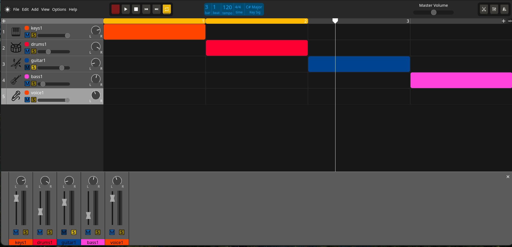
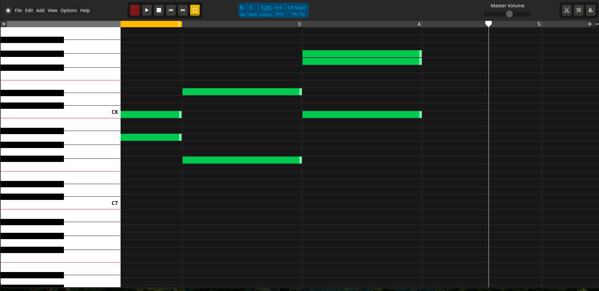
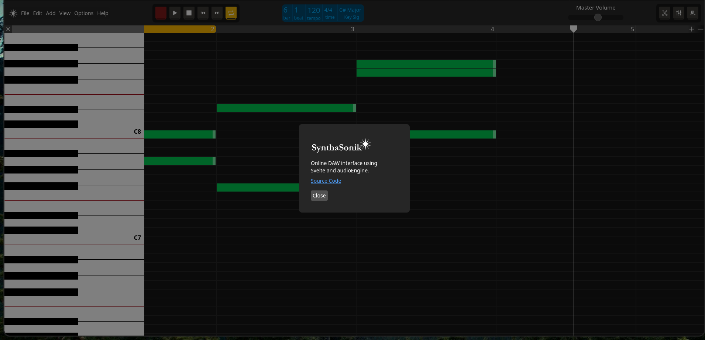

- Web-based DAW
- powered by [`sv`](https://github.com/sveltejs/cli).
- Uses the audioEngine JS library
- Probably the only name not taken by an obscure DJ or speaker company

## Developing

Once you've created a project and installed dependencies with `npm install` (or `pnpm install` or `yarn`), start a development server:

```sh
npm run dev

# or start the server and open the app in a new browser tab
npm run dev -- --open
```

## Building

To create a production version of your app:

```sh
npm run build
```

You can preview the production build with `npm run preview`.

> To deploy your app, you may need to install an [adapter](https://svelte.dev/docs/kit/adapters) for your target environment.

# Screenshots

## Main interface



## Midi interface 



## About window



# Attributions (add later to footer or about)
<a target="_blank" href="https://icons8.com/icon/9978/play">Play</a> icon by <a target="_blank" href="https://icons8.com">Icons8</a>
<a target="_blank" href="https://icons8.com/icon/60362/filled-circle">Circle</a> icon by <a target="_blank" href="https://icons8.com">Icons8</a>
<a target="_blank" href="https://icons8.com/icon/z319sFhd46s4/square-90">Square</a> icon by <a target="_blank" href="https://icons8.com">Icons8</a>
<a target="_blank" href="https://icons8.com/icon/9990/end">Skip</a> icon by <a target="_blank" href="https://icons8.com">Icons8</a>
<a target="_blank" href="https://icons8.com/icon/QRViPceGXUeh/metronome">Metronome</a> icon by <a target="_blank" href="https://icons8.com">Icons8</a>
<a target="_blank" href="https://icons8.com/icon/RILqCZW3kfgv/piano">Piano</a> icon by <a target="_blank" href="https://icons8.com">Icons8</a>
<a target="_blank" href="https://icons8.com/icon/82734/repeat">Loop</a> icon by <a target="_blank" href="https://icons8.com">Icons8</a>
<a target="_blank" href="https://icons8.com/icon/37784/plus-math">Plus</a> icon by <a target="_blank" href="https://icons8.com">Icons8</a>
<a target="_blank" href="https://icons8.com/icon/85458/minus">Minus</a> icon by <a target="_blank" href="https://icons8.com">Icons8</a>
<a target="_blank" href="https://icons8.com/icon/Cg34s6HOqfFv/mute">Mute</a> icon by <a target="_blank" href="https://icons8.com">Icons8</a>
<a target="_blank" href="https://icons8.com/icon/111554/piano">Piano</a> icon by <a target="_blank" href="https://icons8.com">Icons8</a>
<a target="_blank" href="https://icons8.com/icon/84062/adjust">Mixer</a> icon by <a target="_blank" href="https://icons8.com">Icons8</a>
<a target="_blank" href="https://icons8.com/icon/32/cut">Scissors</a> icon by <a target="_blank" href="https://icons8.com">Icons8</a>
waveform by Bohdan Burmich from <a href="https://thenounproject.com/browse/icons/term/waveform/" target="_blank" title="waveform Icons">Noun Project</a> (CC BY 3.0)
